<p align="center">
  
</p>

<h1 align="center">漫迹 · Waytrace</h1>

<p align="center">
  <b>不用打开，不用记得按开始。你走过的路，它都替你记着。</b><br>
  全天记录足迹的 iPhone 和 Apple Watch App：每天走过的路、停留的地点、去过的城市和国家，<br>
  一年一年攒成你自己的地图。
</p>

<p align="center">
  
  
  
  
  
  
</p>

<p align="center">
  <a href="https://apps.apple.com/cn/app/id6827694426"></a>
</p>

<p align="center">
  已在 App Store 上架：iPhone 打开链接，或在 App Store 搜索 <b>「漫迹」</b>。免费，需要 iOS 26 或更新版本；Apple Watch 版随 iPhone 一起安装。
</p>

<p align="center">
  简体中文 · <a href="README_en.md">English</a>
</p>

<p align="center">
  <a href="https://apps.apple.com/cn/app/id6827694426">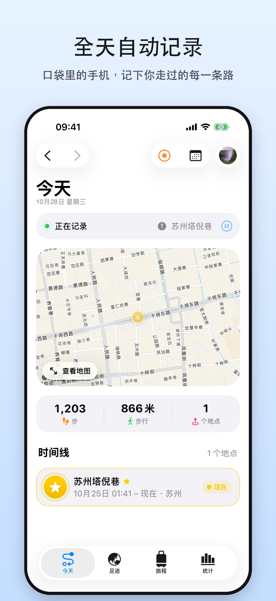</a>
  <a href="https://apps.apple.com/cn/app/id6827694426">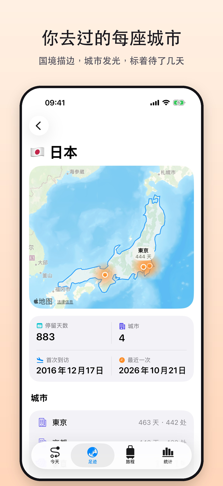</a>
  <a href="https://apps.apple.com/cn/app/id6827694426"></a>
  <a href="https://apps.apple.com/cn/app/id6827694426">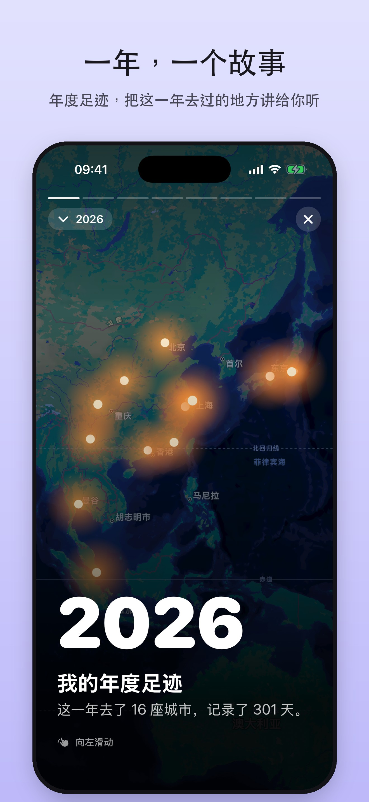</a>
  <a href="https://apps.apple.com/cn/app/id6827694426">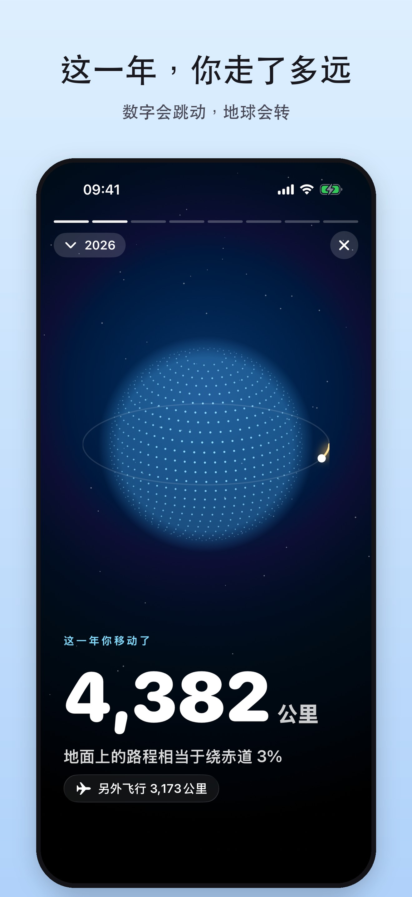</a>
  <a href="https://apps.apple.com/cn/app/id6827694426">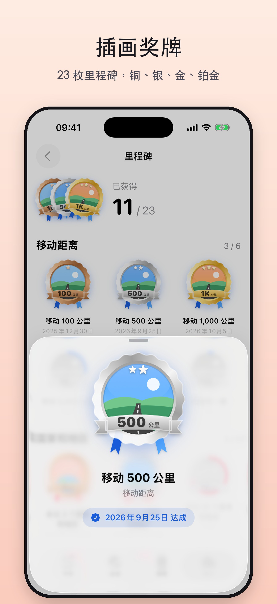</a>
</p>

<p align="center">
  <a href="#-自动记录什么都不用管">记录</a> ·
  <a href="#-旅程">旅程</a> ·
  <a href="#-你去过的世界">足迹</a> ·
  <a href="#-护照与印章">护照与印章</a> ·
  <a href="#-签证夹">签证夹</a> ·
  <a href="#-平行足迹">平行足迹</a> ·
  <a href="#-此生必去">此生必去</a> ·
  <a href="#-旅行盲盒">旅行盲盒</a> ·
  <a href="#-那些会让你停一下的时刻">时刻</a> ·
  <a href="#-apple-watch">Apple Watch</a> ·
  <a href="#隐私">隐私</a> ·
  <a href="#技术">技术</a>
</p>

---

## 🗺️ 自动记录，什么都不用管

<p align="center">
  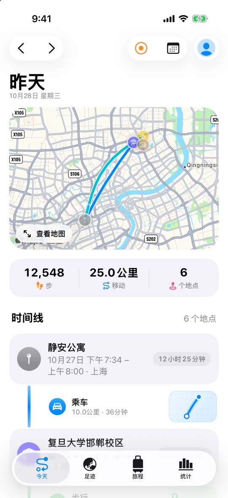
  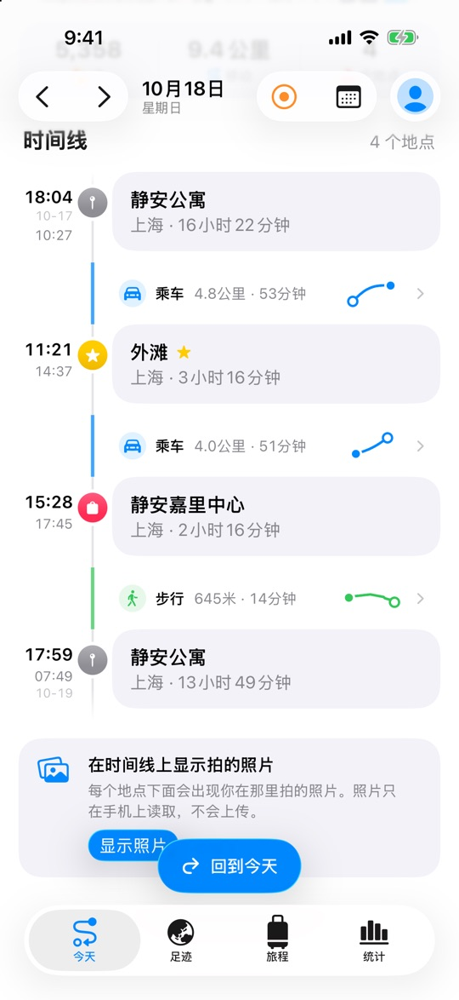
  
</p>

| | |
|---|---|
| **两种记录方式** | **全天自动记录**：出门就有轨迹；或者**想记录时再记录**：只在你点“开始”时用位置，不需要“始终允许”。随时在设置里切换。 |
| **认出怎么走的** | 结合 iPhone 的运动协处理器和速度，分辨步行、跑步、骑行、乘车和飞行，用不同颜色画在地图上。地铁里没有信号的那一段，按手机自己记下的运动时间补上，画成虚线。 |
| **认出在哪里** | 停留几分钟就记一次，并认出是哪家店、哪个景点、哪座城市和国家。 |
| **省电** | 手机不动时定位休眠；在一个地方待满 10 分钟，GPS 完全关闭，换成一圈 150 米的地理围栏，离开时才重新唤醒。 |
| **时间线** | 一天沿着一根细细的时间轴排开：左边是 24 小时制的时刻，每个地点是轴上的一个节点，带上那里拍的照片；路上的一段只占一行，写着怎么走的、多远多久，旁边描出路线。打开“以往路线”，还能在当天的路线下面看到以前在这一带走过的路。 |

**从相册找回过去**：读取照片和视频的拍摄地点，补上 App 出现之前去过的地方。新用户在引导最后一步或“旅程”页就能做，护照当场翻开，这些年的印章一枚枚盖上。之后随时可以在设置里重新导入，只会补上新的地方。所有读取都在手机上完成，照片不会上传。

---

## 🧳 旅程

<p align="center">
  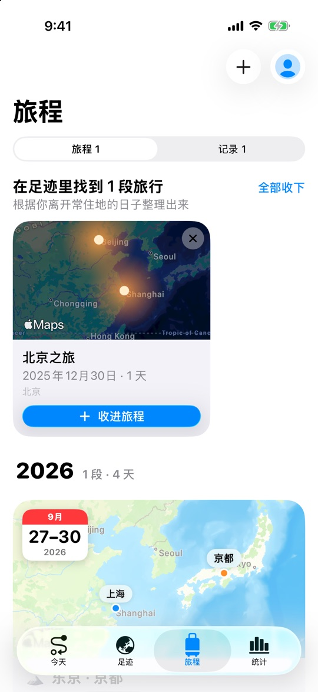
  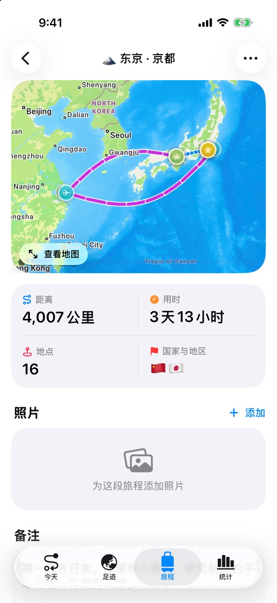
</p>

- 从足迹里**自动找出过去的旅行**：离开常住地 80 公里以上的连续日子，一键收进旅程。
- 旅程汇总这几天的路线、地点和照片，可以写备注、导出 GPX、生成分享图和明信片。
- 徒步、跑步、骑行可以单独用高精度记录，Apple Watch 同时记录心率并存为体能训练。

---

## 🌏 你去过的世界

- **国家和地区**：按大洲筛选（全部 · 亚洲 · 欧洲……），可以搜索，按停留天数、最近去过、最早去过排序；去过的地方再多，也不用一直往下拉。
- **国家页**：描出国境的地图（中国大陆、港澳台不由 App 绘制边界），每座去过的城市一团光；下面是这个国家的入境章和每座城市的城市章。
- **每一次到访**：按“同一城市的连续几天”自动归成一段。历史长的话，一次只看一年，上面一排 12 个月的柱状图，点哪个月就跳到哪个月。
- **全部路线**：“全部足迹”切到“路线”，所有走过的路铺在一张夜景地图上。常走的街道一遍遍叠亮，只走过一次的路淡淡一笔；可以按年份、按步行 · 骑行 · 乘车 · 飞行筛选，底部算出一共走了多远、多少天。多年的轨迹按缩放分三档精度绘制，拖动依然顺滑。

<p align="center">
  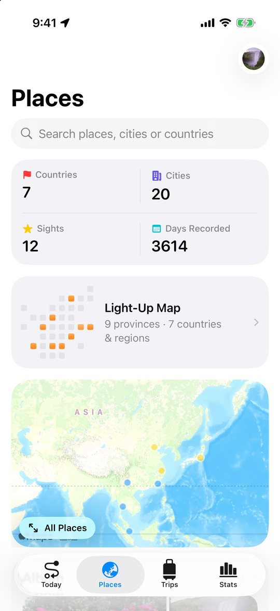
  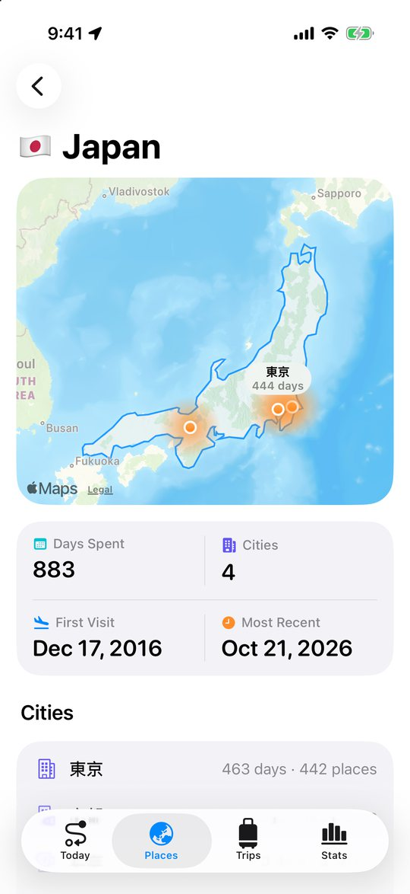
  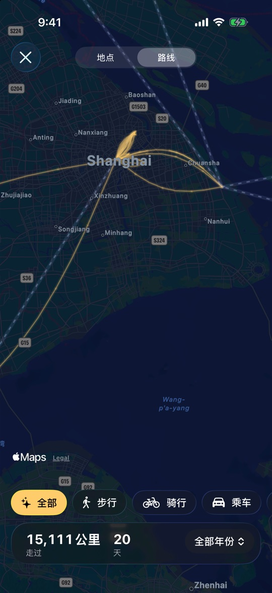
</p>

---

## 🛂 护照与印章

<p align="center">
  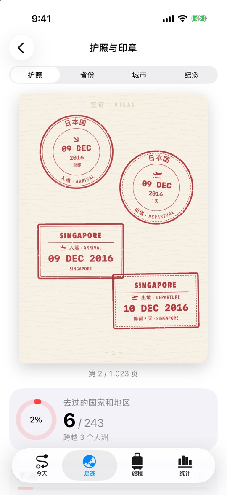
  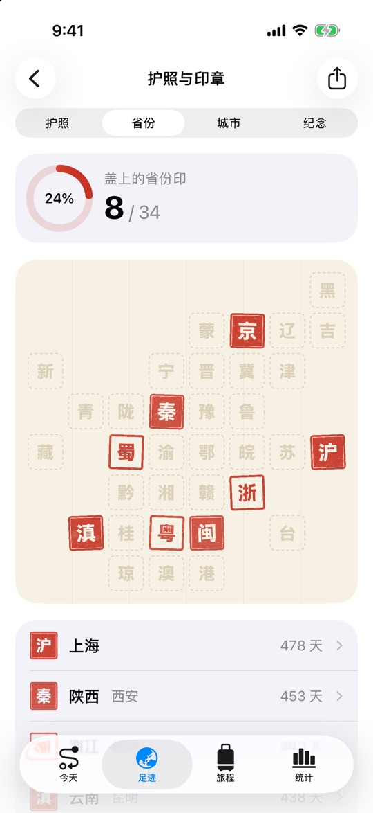
  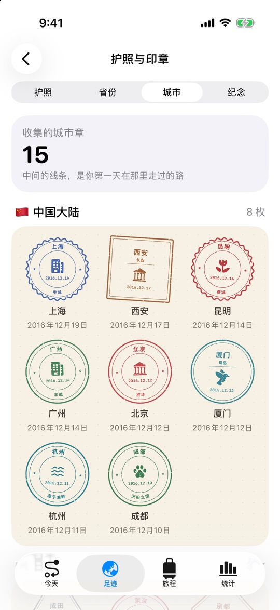
  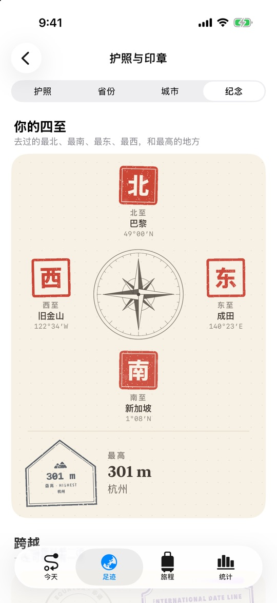
</p>

去过的地方不是一个数字，而是一枚枚盖上去的章，收在一本可以翻页的护照里。

- **入境章与出境章**：每个国家用本国文字（日本国、대한민국、SCHWEIZ · SUISSE），盖着真实的日期和入境口岸；离开时盖出境章，写着“停留 9 天”。你常住的国家不盖章，它是这本护照的签发国。
- **省份印**：中国 34 个省级行政区，每个一方朱砂印：沪、粤、蜀、黔、滇、秦、陇……排成一张方位图。
- **城市章**：每座城市一枚纪念章，**中间印着你第一天在那里走过的路线**，所以每个人的“上海章”都不一样。约 150 座热门城市有专属设计：北京 · 京华，杭州 · 西子湖畔，京都 · 古都，PARIS · LA VILLE LUMIÈRE。
- **纪念章**：跨过赤道、越过国际日期变更线、进入北极圈；每年跨年那一刻在哪里；还有**你的四至**：去过的最北、最南、最东、最西（像老地契一样写着“东至、西至”）和到过的最高点。
- **套章**：集齐一组城市，盖一枚联合章。江南、六大古都、丝绸之路、彩云之南、関西、瑞士阿尔卑斯、美国西部……共 14 套，有篆刻印、路线图、旅行标签三种样式。

**盖章本身就是仪式**，每一类有自己的手感：

| | 像什么 | 怎么盖 |
|---|---|---|
| 入境章 | 海关的橡皮章 | 按住，章慢慢落下，“咚”一声，墨迹晕开 |
| 省份印 | 篆刻石章 | 先蘸印泥，盖下后左右压一压，再慢慢提起 |
| 城市章 | 车站的日期章 | 日期滚轮滚到今天，轻轻“啪”一下 |
| 纪念章、套章 | 烫金 | 落下后一道光从章面扫过；套章由几座城市的章聚拢而成 |

还没盖上的章以**压印**显示：和纸一个颜色，有凹凸的光影，看得清每一个字，但没有墨。

**四种护照**：酒红、藏青、墨绿、夜黑。第一次翻开时挑一本，封面的皮色、烫金或银色徽标，和内页的纸色、防伪底纹一起换；以后在设置里更换，通过 iCloud 在各设备上保持一致。

---

## 🪪 签证夹

<p align="center">
  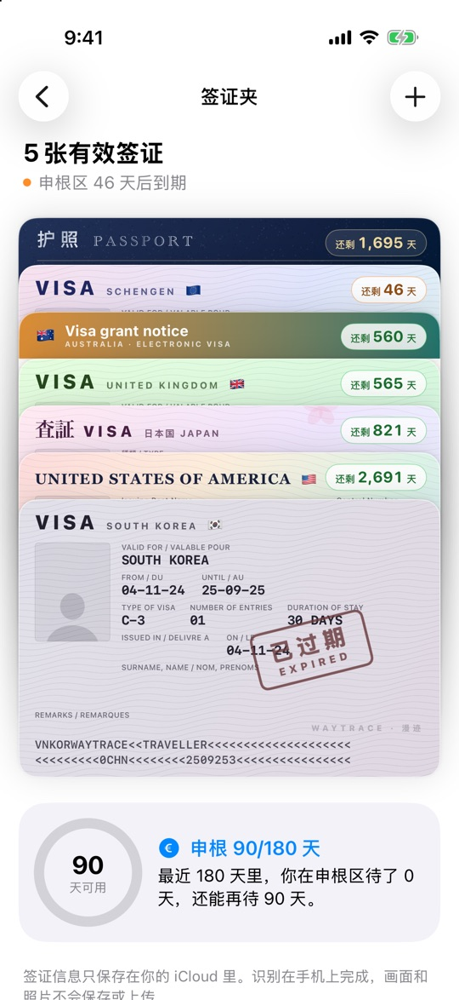
  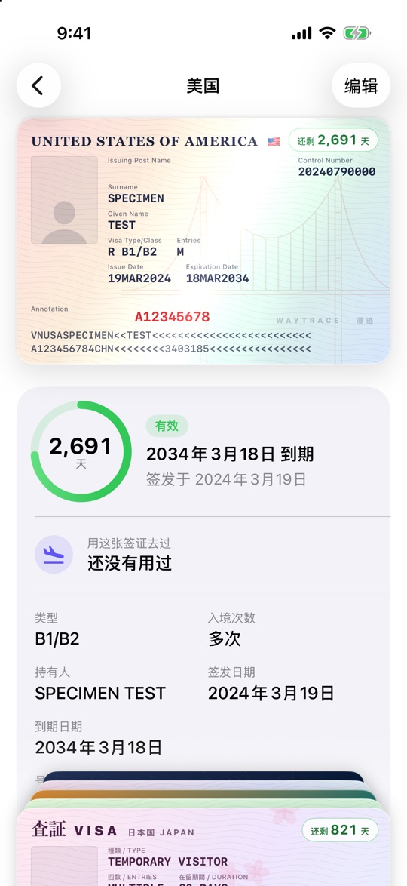
</p>

护照上的签证，像 Apple 钱包里的卡一样叠在一起，每张都写着还剩多少天。

- **照着真签证排版**：美签有 Issuing Post Name、Control Number 和红色签证号，背景一座桥；申根是欧盟统一贴签的 VALID FOR、DURATION OF STAY；日本是“査証 VISA”的日英双语；澳大利亚和新西兰不贴签，就做成一封批准通知。不复制国徽、印章和防伪图案，卡面带一枚淡淡的漫迹水印。
- **对准就读出来**：用相机对准签证页，实时读出国家、类型、入境次数、停留天数和有效期，可以开手电筒。签证底部两行机读码按字段纠错，号码、生日、到期日各自用校验位核对，连续几帧一致才算读好；姓名再和正文印的名字互相印证。也可以从照片识别，或者手动填写。
- **像 Wallet 一样翻看**：点一张，它升到最上面，其余的收成一摞落到底部；倾斜手机，卡面会随之微微转动，一道光从上面滑过。背面是剩余天数的圆环和一格格信息。
- **算得清楚**：申根的 90/180 天，按你真实去过的日子算出还能待几天；每张签证用过几次入境、一共几天；护照不足 6 个月时提醒你。到期前 90 天、30 天、7 天各提醒一次。
- 签证只存在你自己的 iCloud 里；识别在手机上完成，画面和照片不会保存或上传。

---

## 👥 平行足迹

和朋友互相看见彼此的足迹在哪里重叠：**同一个小时擦肩而过**、**同一天在同一个城市**，或者**不同时间去过同一个地方**。

- 只有互相邀请、双方都同意共享之后才会出现；没有通讯录，也没有群组，朋友就是接受了你邀请链接的人。
- 共享的只是一份摘要：每天到过的大致区域（约 20 公里）和每小时所在的约 1 公里方格。家、公司、学校附近 2 公里内的一切、地点名称、具体坐标、路线和照片都不共享。
- 通过 iCloud 共享，比对在各自的手机上完成；随时可以停止，摘要会从 iCloud 删除。

---

## 🌟 此生必去

<p align="center">
  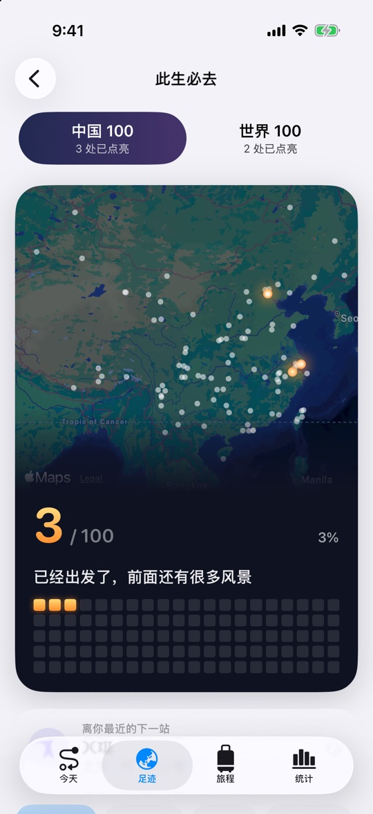
</p>

两份漫迹自己整理的清单：**中国 100 处**（含香港、澳门、台湾）和**世界 100 处**，参考世界遗产名录、国家 5A 级景区和旅行者最常提起的地方。

- **夜空地图**：没去过的地方是一颗颗淡淡的星，去过的会亮起暖金色的光。
- **一百个小格子**：每点亮一处就填上一格，看得见自己走了多远；文案随进度变化，从“第一盏灯，等你去点亮”到“一百处，你都去过了”。
- **不用打卡**：在附近停留过，或在那里拍过照片（包括从相册导入的），就会自动点亮。景区多大，范围就多大。
- **每处一页**：点任何一处，都能看到它最美的样子：一张真实拍摄的照片、一段漫迹写的介绍、最好的季节、离你多远，还可以从空中绕它飞一圈、在街景里走一走。去过的地方，还会轮播你自己在那里拍的照片。
- **回到那一天**：去过的地方，一点就回到你第一次到那里的那一天，看当天的路线和照片。
- **想去**：没去过的地方点一下 ♡ 收进“想去”；还会告诉你**离你最近的下一站**在哪、有多远。
- **新点亮**：上次打开之后新去过的地方，会单独亮一下，告诉你“新点亮了 2 处”。
- **在足迹里认出来**：足迹里凡是此生必去的地方，都挂着一枚金色的“此生必去”标签，卡片镶一道金边；没拍过照片的，就用那张真实照片做封面。点进去，顶上是大幅照片和那段介绍。

照片来自 Wikimedia Commons 上自由授权的作品，随应用一起打包（中国大陆也能看到），每张都在页面底部注明作者和许可协议。

---

## 🎁 旅行盲盒

<p align="center">
  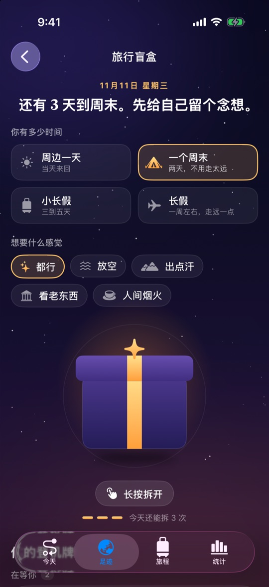
  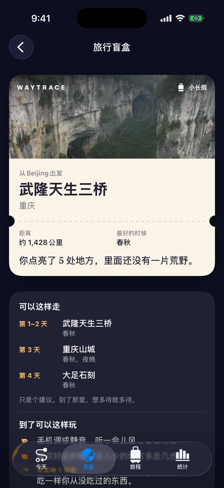
  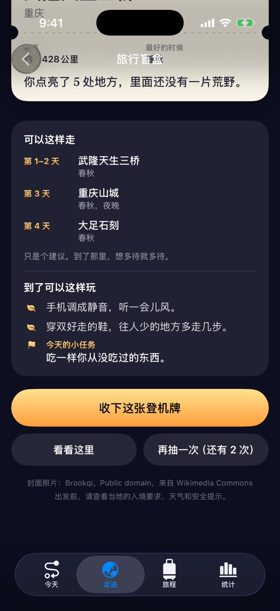
</p>

不知道去哪儿的时候，就拆一个。漫迹知道你去过哪里、还没去过哪里、想去哪里，盲盒只给你一个**还没去过**的地方。在“足迹”页，“此生必去”下面。

- **先懂你的处境**：开场白跟着时间走。周六早上是“今天有空，不如现在就出门”，工作日是“还有 5 天到周末，先给自己留个念想”；节假日临近（元旦、春节、清明、五一、端午、中秋、国庆）会提前说“离国庆还有 N 天”，并替你选好合适的时长。
- **按你有多少时间**：周边一天（当天来回）、一个周末、小长假（三到五天）、长假（一周左右，走远一点）。
- **按你想要的感觉**：都行、放空、出点汗、看老东西、人间烟火。
- **长按拆开**：盒子越抖越厉害，手机跟着震，盖子飞开，一张登机牌翻过来。每天能拆 3 次。
- **一句真实的理由**：只说你的足迹里确实成立的话，比如“离你只有 113 公里，可你还从没来过”“山西的必去之地，你一处都还没点亮”“你点亮了 5 处地方，里面还没有一片荒野”。想去清单里的地方、你手上有有效签证的国家，会更容易被抽到。偶尔也会说：“没有理由。这就是盲盒。”
- **周边一天游**：用 Apple 地图现场找你身边还没去过的山、水、古迹和街区，告诉你几点出发合适（会看你平时是不是早起的人）、开车大概多久、那天的天气，下雨会提醒你。
- **长一点的假期**：给一条顺路的行程，比如“第 1–2 天 武隆天生三桥，第 3 天 重庆山城，第 4 天 大足石刻”，每一站写着最好的季节。只是个建议，想多待就多待。
- **到了怎么玩**：两个玩法加一个**小任务**，比如“手机调成静音，听一会儿风”“吃一样你从没吃过的东西”。
- **收下登机牌**：收下的地方会放进“想去”，登机牌不过期，也不催你。
- **真的走到那里**：漫迹会认出来，盖一个到达邮戳：“73 天前，盲盒把这里交给了你。你真的来了。”

不做付费，也没有社交。附近地点和天气只用你大致的位置向 Apple 地图和 Apple 天气查询，不会离开 Apple。

---

## ✨ 那些会让你停一下的时刻

- **重逢**：时隔一年以上回到同一个地方，会轻轻提醒你：“你上次来这里是 2023 年 4 月 12 日”，天数从 0 一路数上去，再排出第一次、上一次和今天。
- **那年今日**：“今天”页上，往年的今天你在哪里，照片像拍立得一样慢慢显影。
- **旅行明信片**：每段旅程结束后生成一张明信片，正面是照片，背面是你写的话，城市章做邮戳。可以分享，也可以**寄给一年后的自己**：一年后它会落到屏幕上，翻过来给你看。
- **里程碑奖牌**：23 枚插画奖牌，铜、银、金、铂金分级。最新获得的那枚放在最上面；每一类正在努力的那一枚会亮起，写着“还差多少”；点开能看到是哪个国家、哪座城市让你达成的。
- **季节回声**：“这是你连续第 3 年在这个时节来北京”，或者“你已经 5 个月没去那家常去的咖啡馆了”。一周最多说一次，每句只说一遍。
- **那天的天空**：每个地点都写着那天的日出日落、那晚的月相；赶上了日落，会告诉你“日落 17:08 时，你正在这里”。有那天的天气，来自 Apple 天气。

### 你的故事

“统计”页下面，是一组讲你自己的卡片：

- **旅人画像**：根据过去一年，你是“夜行的散步者”“城市收藏家”还是“好奇的探索者”，配上你自己的数字，可以分享。
- **你的里程能走多远**：把你在地面上走过的里程，虚拟地铺在京杭大运河、318 国道、丝绸之路或 66 号公路上，不代表真的到过。里程够到的城市一座座亮起来，每一站有一句介绍。
- **第一次**：第一次出国、第一次在外过夜、第一次凌晨三点还在路上、第一次到每座城市和每处此生必去，按年份排成一条时间线；还有你到过的天涯海角：最北、最南、最东、最西和离家最远。
- **年度足迹**：像故事一样一页页翻，有发光的城市地图、转动的点阵地球、最远那天的路线、照片墙，还有一页**“今年的护照”**，最后是一张可以分享的海报。

<p align="center">
  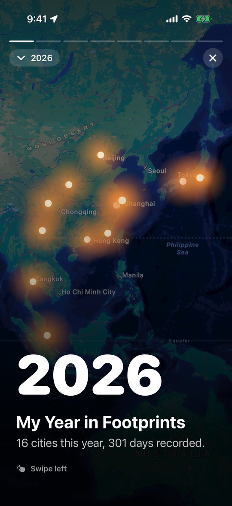
  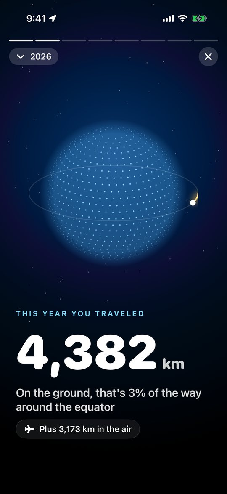
  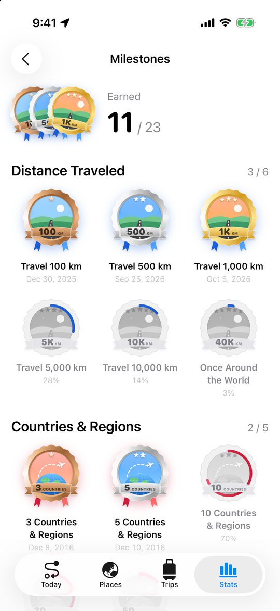
  
</p>

---

## ⌚ Apple Watch

- 打开就是地图：你的位置、今天的路线、所在的地点。
- 不带手机也能记录徒步、跑步、骑行；在 iPhone 上开始记录时，手表自动跟着一起记录。
- 表盘复杂功能：今天走了多远、现在在哪。

---

## 隐私

漫迹**没有自己的服务器**。轨迹、地点、旅程和照片只存在你的设备和你自己的 iCloud 里，开发者看不到。地点名称通过 Apple 地图服务识别，照片只在手机上读取。详见 [PRIVACY.md](PRIVACY.md)。

## 技术

| | |
|---|---|
| 界面 | SwiftUI、MapKit、Swift Charts、iOS 26 Liquid Glass；印章全部用 `Canvas` 和 `Shape` 实时绘制，没有一张图片素材 |
| 存储与同步 | SwiftData + CloudKit 私有数据库；印章由停留记录推算，不额外存储；“看过的盖章动画”和明信片通过 iCloud 键值存储同步 |
| 后台定位 | `CLLocationUpdate.liveUpdates` + `CLBackgroundActivitySession`；久停时改用 `CLMonitor` 地理围栏，显著位置变化兜底 |
| 地点 | `MKReverseGeocodingRequest`、`MKLocalPointsOfInterestRequest`；国内地图 WGS-84 → GCJ-02 转换 |
| 全部路线 | 每段轨迹按街道、城市、国家三档精度预先简化，缓存在本地，只增量读取新轨迹；`MKMultiPolyline` 分层绘制，重叠处自然变亮 |
| 签证识别 | VisionKit `DataScannerViewController` 实时识别，Vision 文字识别读照片；ICAO 9303 机读码按字段纠错、校验位验证，多帧投票；Core Motion 驱动卡面光泽 |
| 平行足迹 | CloudKit 区域共享（`CKShare`），摘要按天去重上传 |
| 运动与健康 | CoreMotion 识别出行方式，HealthKit 步数 |
| Apple Watch | watchOS SwiftUI App、WidgetKit 复杂功能、`HKWorkoutSession`、WatchConnectivity |
| 实时活动 | ActivityKit：锁屏、灵动岛、手表智能叠放 |
| 多语言 | String Catalog，简体中文和英文，App 内切换；印章上印当地文字，周围的名字跟随 App 语言 |

轨迹点按段压缩（LZFSE）成 `TrackChunk`，一天只有几十条 CloudKit 记录。国家、城市、印章、里程碑和旅程发现都在后台线程计算；在 6000 个地点、上千页护照的压力数据下，页面也随翻随建，不卡顿。没有任何第三方依赖。

<details>
<summary>项目结构</summary>

```
RecordPath/
├── App/            入口、Tab 结构
├── Persistence/    SwiftData 模型、轨迹编码、iCloud 同步
├── Location/       后台定位引擎、出行方式识别
├── Places/         地点识别、常去地点
├── Health/         步数
├── Account/        Apple 登录
├── Features/
│   ├── Today/          今天、时间线、那年今日
│   ├── World/          足迹、国家页、大洲筛选
│   ├── Stamps/         护照、护照样式、印章绘制、盖章动效、纪念章
│   ├── Visas/          签证夹、签证卡面、实时扫描
│   ├── Trips/          旅程、明信片
│   ├── Celebration/    盖章仪式、重逢、里程碑
│   ├── Stats/          统计、年度足迹
│   ├── Onboarding/     引导、从相册找回
│   └── Settings/
├── Watch/          和手表的同步
└── Shared/         印章推算与目录、地图、相册导入、旅程发现、GPX
Common/             iPhone、手表、复杂功能共用的代码
WaytraceWatch/      Apple Watch App
WaytraceWidgets/    表盘复杂功能
WaytraceLiveActivity/  实时活动
```
</details>

## 运行

- Xcode 26 或更高版本；iOS 26+（iPhone），watchOS 26+。
- 打开 `RecordPath.xcodeproj`，选择 RecordPath scheme 运行即可，不需要安装任何依赖。
- 在真机上运行需要把 Signing 里的 Team 换成你自己的。
- 调试版的“设置 › 开发者”可以生成演示数据、预览各种仪式；也可以用启动参数：

```bash
# 单元测试
xcodebuild test -project RecordPath.xcodeproj -scheme RecordPath \
  -destination 'platform=iOS Simulator,name=iPhone 17' -only-testing:RecordPathTests

# 启动时加载演示数据和 6000 个照片地点（空数据时）
xcrun simctl launch booted com.honywen.waytrace -stressData

# 只预览某一种盖章仪式：province / city / country / special / set / reunion / postcard
xcrun simctl launch booted com.honywen.waytrace -ceremonySamples province

# 在模拟器里模拟一段移动
xcrun simctl location booted start --speed=12 31.2245,121.4466 31.2310,121.4650 31.2400,121.4900
```

每一轮的设计取舍和实测记录在 [PRODUCT_REVIEW.md](PRODUCT_REVIEW.md)，上架前的事项在 [LAUNCH_CHECKLIST.md](LAUNCH_CHECKLIST.md)。

## 许可

本项目采用 **[PolyForm Noncommercial 1.0.0](LICENSE)** 许可。

- ✅ 个人学习、研究、自用、修改，以及非营利组织、教育机构使用：可以。
- ❌ 任何商业用途（包括上架收费或带广告的 App、用于公司产品或服务）：不可以。
- 如需商业授权，请通过 GitHub 联系作者。

Copyright © 2026 lxyeternal
