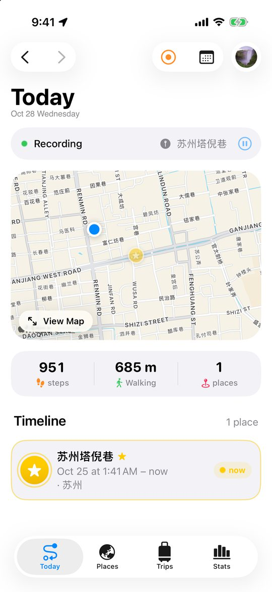
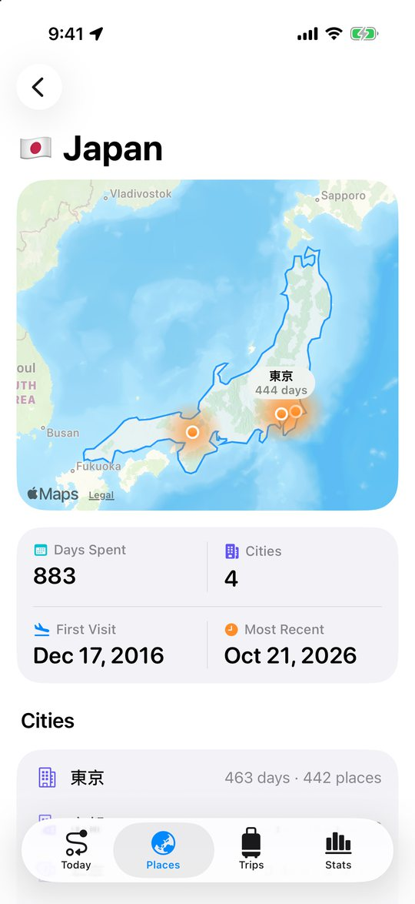
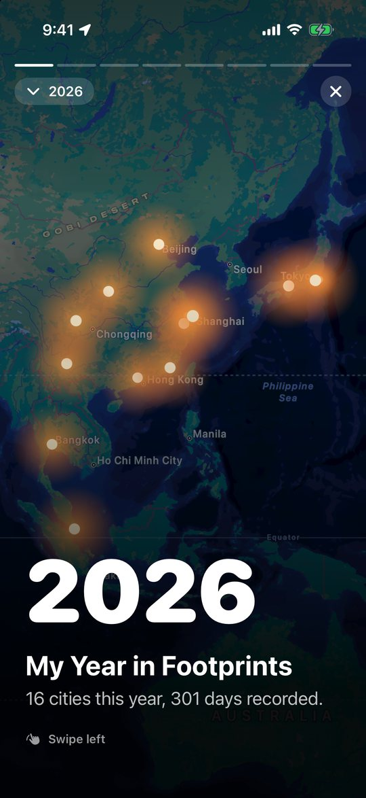
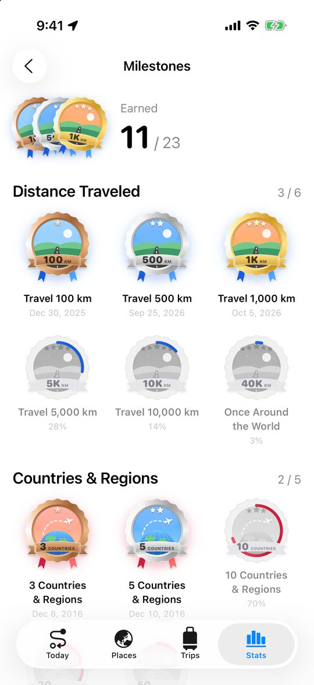
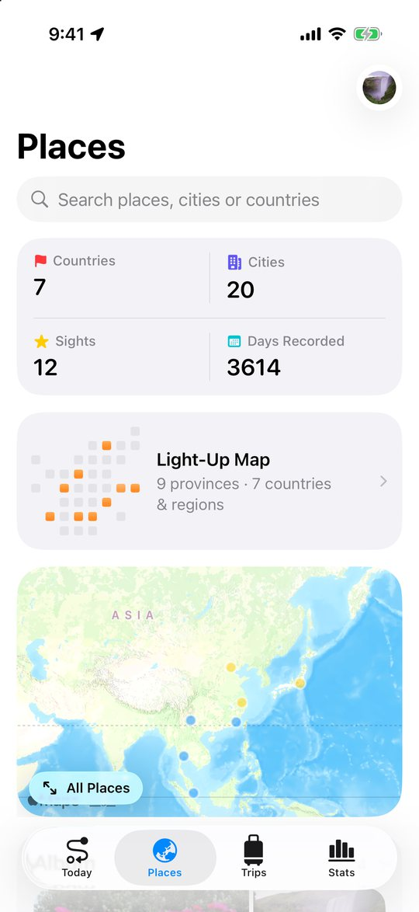
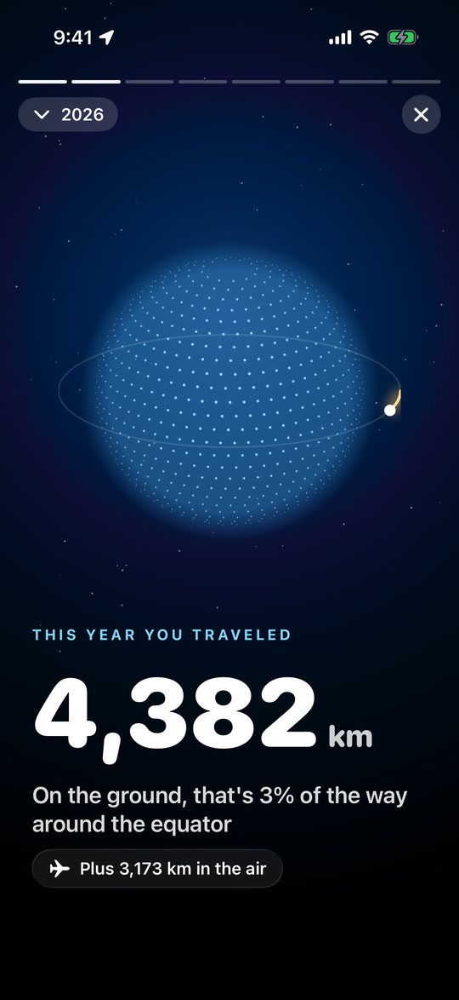

<p align="center">
  
</p>

<h1 align="center">Waytrace · 漫迹</h1>

<p align="center">
  <b>No need to open it, no need to press start. It remembers every road you take.</b><br>
  An all-day footprint tracker for iPhone and Apple Watch: your routes, the places you stop, the cities and countries you visit, growing year by year into a map of your own.
</p>

<p align="center">
  
  
  
  
  
</p>

<p align="center">
  <a href="README.md">简体中文</a> · English
</p>

<p align="center">
  
  
  
  
</p>

---

## What it does

### 🗺️ Records itself
- **All day, in the background.** The phone in your pocket is enough. Walking, cycling, driving and flying are told apart and drawn in their own colours.
- **Knows where you were.** Stay a few minutes and it becomes a visit, named by shop, sight, city and country.
- **A timeline of your day:** stay → on the way → stay, each place with the photos you took there. Tap a photo to see it; open a place to view it first and edit only if you want to.
- **Easy on the battery**, with three precision levels, and correct on maps in mainland China.

### 📸 Lights up your past from Photos
- Scans the locations of tens of thousands of photos and videos and **fills in everywhere you went before the app existed**, lighting up cities, provinces and countries.
- One visit per city per day; anything already recorded is skipped.
- Everything is read on the phone. Photos are never uploaded or copied.

### 🌏 The world you've seen
- **Light-up map:** China's 34 provinces as tiles and a flag wall per continent. Tap one for everything you did there.
- **Country pages:** the country outlined on the map (no app-drawn borders for mainland China, Hong Kong, Macao or Taiwan), each city you visited glowing with its number of days.
- **Visits that make sense:** thousands of stops grouped into runs of days in one city, by year, each with its map, a photo collage and every day's tracks.

<p align="center">
  
  
  
</p>

### 🧳 Trips, sorted for you
- **Finds your past trips** in your history: consecutive days 80 km+ from home, kept with one tap.
- A trip gathers those days' routes, places and photos, with notes, GPX export and a share image.
- Hikes, runs and rides can be recorded on their own at high precision, with Apple Watch adding heart rate and saving a workout.

### ✨ Moments worth marking
- **Lighting up:** your first time in a new country or province plays a ceremony: the map lights up from grey, the flag drops in, confetti falls. Press and hold to light it.
- **Illustrated medals:** 23 milestones, each a small painting, in bronze, silver, gold and platinum.
- **Year in Footprints:** a story to swipe through: a glowing map of your cities, a turning dotted globe, a trail of footprints, flags dropping onto the map, your longest day's route, a wall of polaroids, and a poster to share.

<p align="center">
  
  
  
</p>

### ⌚ Apple Watch
- Opens to a map: where you are, today's route, the place you're at.
- Records hikes, runs and rides without the phone; start a recording on iPhone and the watch joins in.
- Complications: how far today, and where you are now.

---

## Privacy

Waytrace has **no server of its own**. Tracks, places, trips and photos stay on your devices and in your own iCloud; the developer can't see them. Places are named with Apple's map service; photos are read on the phone only. See [PRIVACY.md](PRIVACY.md).

## Under the hood

| | |
|---|---|
| UI | SwiftUI, MapKit, Swift Charts, iOS 26 Liquid Glass |
| Storage & sync | SwiftData + CloudKit private database, automatic sync |
| Background location | `CLLocationUpdate.liveUpdates` + `CLBackgroundActivitySession`, relaunched by significant-change after termination |
| Places | `MKReverseGeocodingRequest`, `MKLocalPointsOfInterestRequest`; WGS-84 → GCJ-02 on maps in mainland China |
| Motion & health | CoreMotion for travel mode, HealthKit for steps |
| Apple Watch | watchOS SwiftUI app, WidgetKit complications, `HKWorkoutSession`, WatchConnectivity |
| Live Activities | ActivityKit: Lock Screen, Dynamic Island, Smart Stack |
| Languages | String Catalogs, Simplified Chinese and English, switchable in the app |

Track points are compressed (LZFSE) into `TrackChunk`s, so a day is a few dozen CloudKit records. Every summary — countries, cities, the light-up map, milestones, trip finding — is computed off the main thread, so thousands of places stay smooth. No third-party dependencies.

<details>
<summary>Project layout</summary>

```
RecordPath/
├── App/            entry point, tabs
├── Persistence/    SwiftData models, track encoding, iCloud sync
├── Location/       background location engine, travel modes
├── Places/         place naming, frequent places
├── Health/         steps
├── Account/        Sign in with Apple
├── Features/       Today / Places / Trips / Stats / Celebrations / Settings / Onboarding
├── Watch/          sync with the watch
└── Shared/         maps, statistics, photo import, trip finding, GPX
Common/             shared by iPhone, watch and complications
WaytraceWatch/      Apple Watch app
WaytraceWidgets/    complications
WaytraceLiveActivity/  Live Activity
```
</details>

## Running it

- Xcode 26 or later; iOS 26+ (iPhone), watchOS 26+.
- Open `RecordPath.xcodeproj` and run the RecordPath scheme. Nothing to install.
- To run on a device, set your own Team under Signing.
- Debug builds have Settings › Developer › Generate Demo Data for trying it in the simulator.

```bash
# Unit tests
xcodebuild test -project RecordPath.xcodeproj -scheme RecordPath \
  -destination 'platform=iOS Simulator,name=iPhone 17' -only-testing:RecordPathTests

# Simulate moving around in the simulator
xcrun simctl location booted start --speed=12 31.2245,121.4466 31.2310,121.4650 31.2400,121.4900
```

Design decisions and test notes for every round are in [PRODUCT_REVIEW.md](PRODUCT_REVIEW.md) (Chinese).

## License

Licensed under **[PolyForm Noncommercial 1.0.0](LICENSE)**.

- ✅ Personal use, study, research, modification, and use by non-profits and educational institutions.
- ❌ Any commercial use, including paid or ad-supported apps and use in a company's products or services.
- For a commercial license, contact the author through GitHub.

Copyright © 2026 lxyeternal
