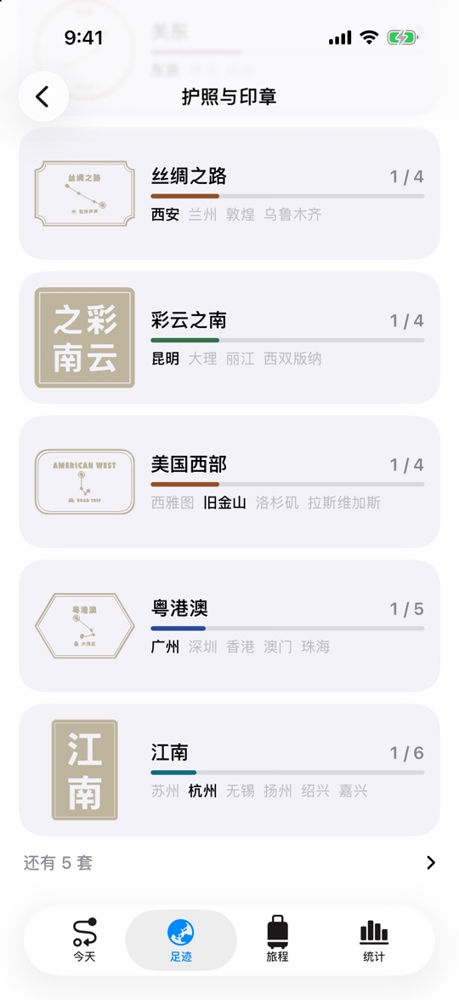

<p align="center">
  
</p>

<h1 align="center">Waytrace · 漫迹</h1>

<p align="center">
  <b>No need to open it, no need to press start. It remembers every road you take.</b><br>
  An all-day footprint tracker for iPhone and Apple Watch: your routes, the places you stop, the cities and countries you visit,<br>
  stamped one by one into a passport of your own.
</p>

<p align="center">
  
  
  
  
  
  
</p>

<p align="center">
  <a href="README.md">简体中文</a> · English
</p>

<p align="center">
  
  
  
  
</p>

<p align="center">
  <a href="#-records-itself">Recording</a> ·
  <a href="#-passport-and-stamps">Passport and stamps</a> ·
  <a href="#-moments-that-make-you-pause">Moments</a> ·
  <a href="#-the-world-youve-seen">Places</a> ·
  <a href="#-trips">Trips</a> ·
  <a href="#-apple-watch">Apple Watch</a> ·
  <a href="#privacy">Privacy</a> ·
  <a href="#under-the-hood">Under the hood</a>
</p>

---

## 🗺️ Records itself

| | |
|---|---|
| **Two ways to record** | **All day**, so every outing has its route; or **only when you ask**, using location only after you press Start, with no "Always" permission needed. Switch any time in Settings. |
| **How you got there** | The iPhone's motion coprocessor and your speed tell walking, running, cycling, driving and flying apart, each drawn in its own colour. |
| **Where you were** | A few minutes in one place becomes a stay, named as the shop, sight, city and country it is. |
| **Easy on the battery** | Location sleeps while the phone is still. After ten minutes in one place GPS turns off entirely, replaced by a 150 m geofence that wakes it when you leave. |
| **Timeline** | Each day reads stay → journey → stay, every place with the photos you took there. |

**Bring back the past from Photos**: the places your photos and videos were taken fill in where you went before the app existed. New users can do it in the last step of onboarding, and the passport opens as the years of stamps land. Everything is read on the phone; photos are never uploaded.

---

## 🛂 Passport and stamps

<p align="center">
  
  
  
  
</p>

The places you've been aren't a number. They're stamps, pressed one by one into a passport you can leaf through.

- **Entry and exit stamps**: each country in its own script (日本国, 대한민국, SCHWEIZ · SUISSE), with the real date and the airport or border crossing; leaving adds an exit stamp, "stayed 9 days". Your home country doesn't stamp you: it issues the passport.
- **Province seals**: China's 34 provinces, each a cinnabar seal with its one-character name: 沪, 粤, 蜀, 黔, 滇, 秦, 陇… laid out roughly where they are.
- **City stamps**: one for every city, **with the path you walked on your first day there drawn in the middle**, so no two people's Shanghai stamp look alike. About 150 well-known cities have their own design: 北京 · 京华, 京都 · 古都, PARIS · LA VILLE LUMIÈRE.
- **Keepsakes**: crossing the equator or the date line, the Arctic Circle; where each New Year began; and **your four corners**, the farthest north, south, east and west you've been, written like an old deed, plus the highest point you've reached.
- **Sets**: visit every city in a group to earn its joint stamp: Jiangnan, the Six Ancient Capitals, the Silk Road, Yunnan, Kansai, the Swiss Alps, the American West and more, 14 in all, as carved seals, route maps or luggage labels.

**Stamping is the ceremony**, and each kind feels like the real thing:

| | Like | How it's pressed |
|---|---|---|
| Entry stamp | A customs rubber stamp | Hold, it comes down, a hard thump, the ink spreads |
| Province seal | A carved stone seal | Inked in a dish of paste, pressed, rocked side to side, lifted slowly |
| City stamp | A station date stamp | The date wheels roll to today, then a light tap |
| Keepsakes and sets | Gold foil | A line of light runs across it; a set's cities gather into its stamp |

Stamps not yet earned are **blind-embossed**: paper-coloured, in relief, every character readable but uninked.

---

## ✨ Moments that make you pause

- **Back again**: return somewhere after more than a year and you're told gently, "you were last here on 12 April 2023", the days counting up, with your first visit, last visit and today in a line.
- **On this day**: on the Today page, where you were on this date in earlier years, the photo developing like a Polaroid.
- **Travel postcards**: every finished trip makes a postcard, a photo on the front, your words on the back, the city stamp as the postmark. Share it, or **send it to yourself a year from now**: when the day comes it drops onto the screen and turns over.
- **Milestone medals**: 23 illustrated medals in bronze, silver, gold and platinum, lit by pressing and holding.
- **Your year**: page by page like a story, with glowing city maps, a turning dotted globe, your longest day's route, a wall of photos and a page of **this year's passport**, ending in a poster to share.

<p align="center">
  
  
  
  
</p>

---

## 🌏 The world you've seen

- **Countries and regions**: filter by continent (All · Asia · Europe…), search, and sort by days, most recent or earliest, so a long list never means endless scrolling.
- **Country pages**: the country outlined (the app draws no borders for mainland China, Hong Kong, Macao or Taiwan), each city you visited a glow of light, then the country's entry stamps and every city's stamp.
- **Every visit**: grouped as runs of days in one city. A long history shows a year at a time, with a twelve-month bar chart on top; tap a month to jump to it.

<p align="center">
  
  
  
</p>

---

## 🧳 Trips

- **Past trips found for you**: runs of days more than 80 km from home, saved as a trip in one tap.
- A trip gathers those days' routes, places and photos; add notes, export GPX, make a share card or a postcard.
- Hikes, runs and rides can be recorded on their own at high precision, with Apple Watch recording heart rate and saving a workout.

## ⌚ Apple Watch

- Opens to a map: where you are, today's route, the place you're at.
- Record hikes, runs and rides without your phone; start one on iPhone and the watch joins in.
- Complications: how far you've gone today and where you are.

---

## Privacy

Waytrace **has no server of its own**. Your routes, places, trips and photos live only on your devices and in your own iCloud; the developer can't see them. Place names come from Apple's map service, and photos are only read on the phone. See [PRIVACY.md](PRIVACY.md).

## Under the hood

| | |
|---|---|
| Interface | SwiftUI, MapKit, Swift Charts, iOS 26 Liquid Glass; every stamp is drawn live with `Canvas` and `Shape`, with no image assets |
| Storage and sync | SwiftData with a CloudKit private database; stamps are worked out from stays rather than stored; seen-stamp state and postcards sync through iCloud key-value storage |
| Background location | `CLLocationUpdate.liveUpdates` + `CLBackgroundActivitySession`; a `CLMonitor` geofence during long stays, with significant-change as a backstop |
| Places | `MKReverseGeocodingRequest`, `MKLocalPointsOfInterestRequest`; WGS-84 → GCJ-02 for maps in China |
| Motion and health | CoreMotion for how you travel, HealthKit for steps |
| Apple Watch | watchOS SwiftUI app, WidgetKit complications, `HKWorkoutSession`, WatchConnectivity |
| Live Activities | ActivityKit: Lock Screen, Dynamic Island, watch Smart Stack |
| Languages | String Catalog, Simplified Chinese and English, switchable in the app; stamps print the place's own script, names around them follow the app's language |

Track points are compressed (LZFSE) into `TrackChunk`s, a few dozen CloudKit records a day. Countries, cities, stamps, milestones and trip finding are computed on a background thread; with 6,000 places and a passport of over a thousand pages, pages are still built only as they're turned. No third-party dependencies.

<details>
<summary>Project layout</summary>

```
RecordPath/
├── App/            Entry point, tabs
├── Persistence/    SwiftData models, track encoding, iCloud sync
├── Location/       Background location engine, travel mode
├── Places/         Place naming, frequent places
├── Health/         Steps
├── Account/        Sign in with Apple
├── Features/
│   ├── Today/          Today, timeline, on this day
│   ├── World/          Places, country pages, continent filter
│   ├── Stamps/         Passport, stamp drawing, landing motion, keepsakes
│   ├── Trips/          Trips, postcards
│   ├── Celebration/    Stamping ceremonies, back again, milestones
│   ├── Stats/          Stats, your year
│   ├── Onboarding/     Onboarding, places from Photos
│   └── Settings/
├── Watch/          Sync with the watch
└── Shared/         Stamp book and catalog, maps, photo import, trip finding, GPX
Common/             Code shared by iPhone, watch and complications
WaytraceWatch/      Apple Watch app
WaytraceWidgets/    Complications
WaytraceLiveActivity/  Live Activities
```
</details>

## Running it

- Xcode 26 or later; iOS 26+ (iPhone), watchOS 26+.
- Open `RecordPath.xcodeproj` and run the RecordPath scheme. There's nothing to install.
- To run on a device, change the Team under Signing to your own.
- Debug builds have Settings › Developer for demo data and ceremony previews, and launch arguments too:

```bash
# Unit tests
xcodebuild test -project RecordPath.xcodeproj -scheme RecordPath \
  -destination 'platform=iOS Simulator,name=iPhone 17' -only-testing:RecordPathTests

# Load demo data plus 6,000 photo places on launch (empty store only)
xcrun simctl launch booted com.honywen.waytrace -stressData

# Preview one kind of ceremony: province / city / country / special / set / reunion / postcard
xcrun simctl launch booted com.honywen.waytrace -ceremonySamples province

# Simulate a walk in the simulator
xcrun simctl location booted start --speed=12 31.2245,121.4466 31.2310,121.4650 31.2400,121.4900
```

Design decisions and field testing for each round are in [PRODUCT_REVIEW.md](PRODUCT_REVIEW.md); the pre-launch list is in [LAUNCH_CHECKLIST.md](LAUNCH_CHECKLIST.md).

## License

Licensed under **[PolyForm Noncommercial 1.0.0](LICENSE)**.

- ✅ Personal study, research, own use and modification, and use by nonprofits and educational institutions: yes.
- ❌ Any commercial use (including paid or ad-supported apps, or use in a company's products or services): no.
- For a commercial license, contact the author on GitHub.

Copyright © 2026 lxyeternal
