<p align="center">
  
</p>

<h1 align="center">Waytrace · 漫迹</h1>

<p align="center">
  <b>No need to open it, no need to press start. It remembers every road you take.</b><br>
  An all-day footprint tracker for iPhone and Apple Watch: the roads you take each day, the places you stop, the cities and countries you visit,<br>
  growing year by year into a map of your own.
</p>

<p align="center">
  
  
  
  
  
  
</p>

<p align="center">
  <a href="https://apps.apple.com/app/id6827694426"></a>
</p>

<p align="center">
  Now on the App Store: open the link on your iPhone, or search for <b>“漫迹”</b> (the listing’s name) in the App Store. Free in China mainland, the US and Singapore; requires iOS 26 or later; the Apple Watch app installs along with it.
</p>

<p align="center">
  <a href="README.md">简体中文</a> · English
</p>

<p align="center">
  <a href="https://apps.apple.com/app/id6827694426">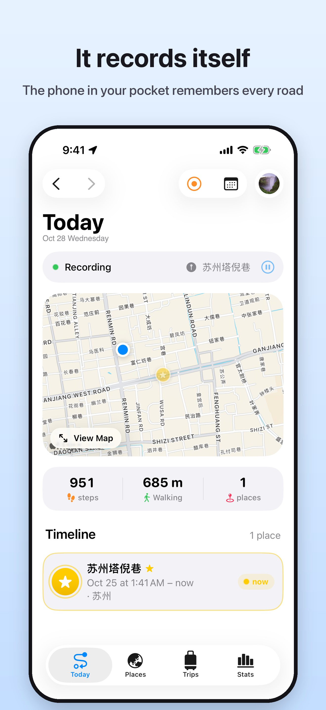</a>
  <a href="https://apps.apple.com/app/id6827694426">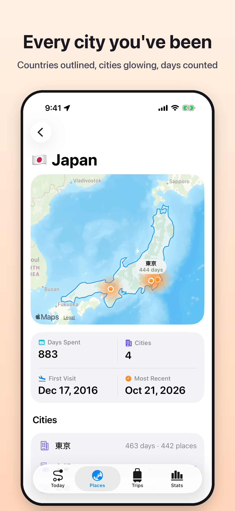</a>
  <a href="https://apps.apple.com/app/id6827694426">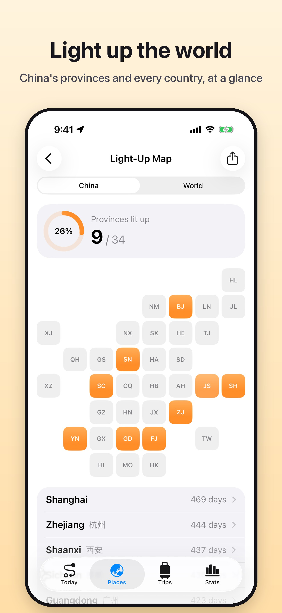</a>
  <a href="https://apps.apple.com/app/id6827694426">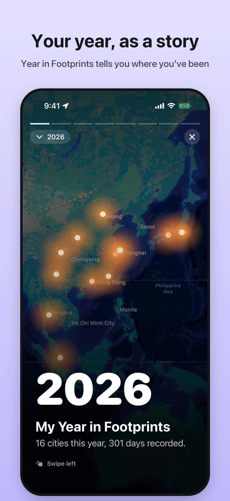</a>
  <a href="https://apps.apple.com/app/id6827694426">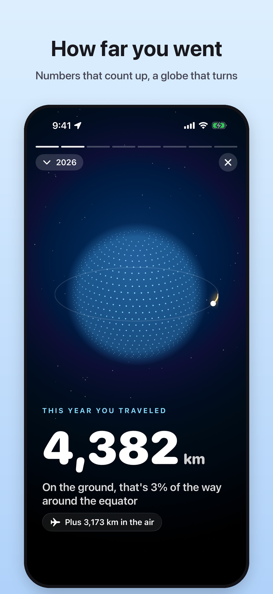</a>
  <a href="https://apps.apple.com/app/id6827694426">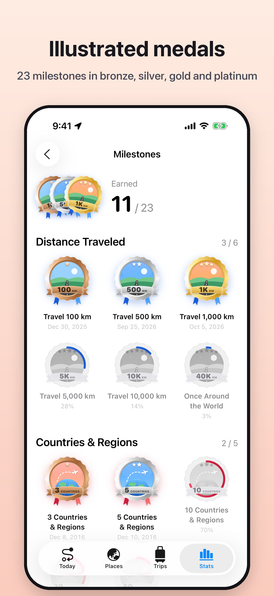</a>
</p>

<p align="center">
  <a href="#-records-itself">Recording</a> ·
  <a href="#-trips">Trips</a> ·
  <a href="#-the-world-youve-seen">Places</a> ·
  <a href="#-passport-and-stamps">Passport and stamps</a> ·
  <a href="#-visa-wallet">Visa wallet</a> ·
  <a href="#-parallel-footprints">Parallel footprints</a> ·
  <a href="#-places-for-a-lifetime">Places for a lifetime</a> ·
  <a href="#-travel-blind-box">Travel blind box</a> ·
  <a href="#-moments-that-make-you-pause">Moments</a> ·
  <a href="#-apple-watch">Apple Watch</a> ·
  <a href="#privacy">Privacy</a> ·
  <a href="#under-the-hood">Under the hood</a>
</p>

---

## 🗺️ Records itself

<p align="center">
  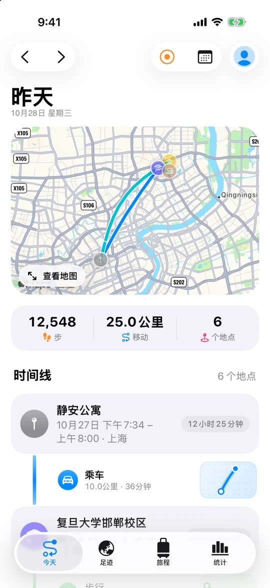
  
  
</p>

| | |
|---|---|
| **Two ways to record** | **All day**, so every outing has its route; or **only when you ask**, using location only after you press Start, with no "Always" permission needed. Switch any time in Settings. |
| **How you got there** | The iPhone's motion coprocessor and your speed tell walking, running, cycling, driving and flying apart, each drawn in its own colour. A subway ride with no signal is filled in from the phone's own motion history and drawn dashed. |
| **Where you were** | A few minutes in one place becomes a stay, named as the shop, sight, city and country it is. |
| **Easy on the battery** | Location sleeps while the phone is still. After ten minutes in one place GPS turns off entirely, replaced by a 150 m geofence that wakes it when you leave. |
| **Timeline** | Each day runs down a fine line: the times in the margin, each place a node on it with the photos you took there, and each journey a single line saying how you went, how far and how long, with the route traced beside it. Turn on Past Routes to see the roads you've taken around there on other days, beneath today's. |

**Bring back the past from Photos**: the places your photos and videos were taken fill in where you went before the app existed. New users can do it in the last step of onboarding or from the Trips tab, and the passport opens as the years of stamps land. Run it again any time from Settings; only new places are added. Everything is read on the phone; photos are never uploaded.

---

## 🧳 Trips

<p align="center">
  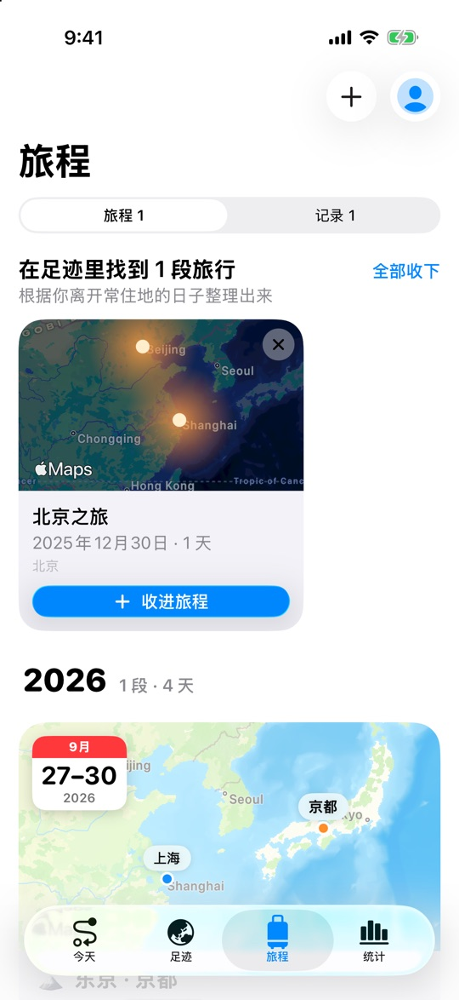
  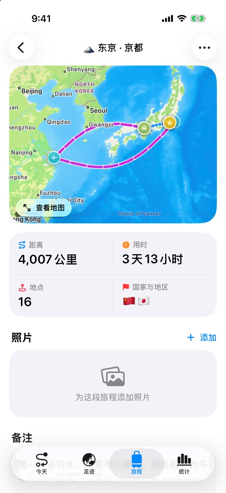
</p>

- **Past trips found for you**: runs of days more than 80 km from home, saved as a trip in one tap.
- A trip gathers those days' routes, places and photos; add notes, export GPX, make a share card or a postcard.
- Hikes, runs and rides can be recorded on their own at high precision, with Apple Watch recording heart rate and saving a workout.

---

## 🌏 The world you've seen

- **Countries and regions**: filter by continent (All · Asia · Europe…), search, and sort by days, most recent or earliest, so a long list never means endless scrolling.
- **Country pages**: the country outlined (the app draws no borders for mainland China, Hong Kong, Macao or Taiwan), each city you visited a glow of light, then the country's entry stamps and every city's stamp.
- **Every visit**: grouped as runs of days in one city. A long history shows a year at a time, with a twelve-month bar chart on top; tap a month to jump to it.
- **Every road**: switch All Places to Routes and every road you've travelled lies on one night map. Streets you take every day glow brighter with each pass; a one-off detour is a faint stroke. Filter by year or by walking, cycling, driving and flying, with the distance and days totted up below. Years of tracks are drawn at three levels of detail, so the map still pans smoothly.

<p align="center">
  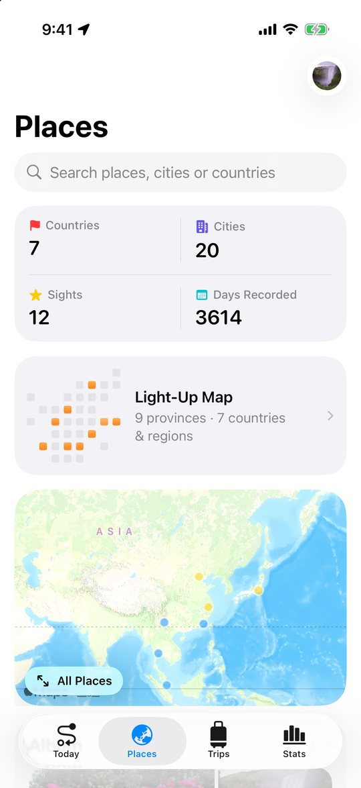
  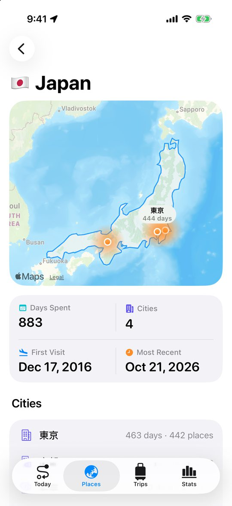
  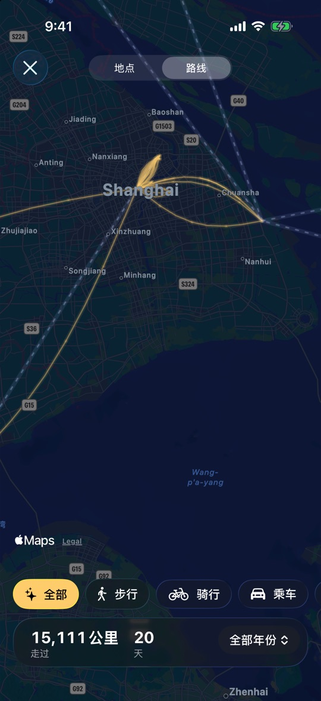
</p>

---

## 🛂 Passport and stamps

<p align="center">
  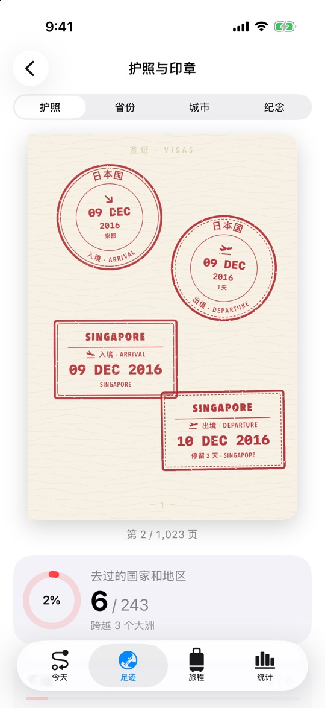
  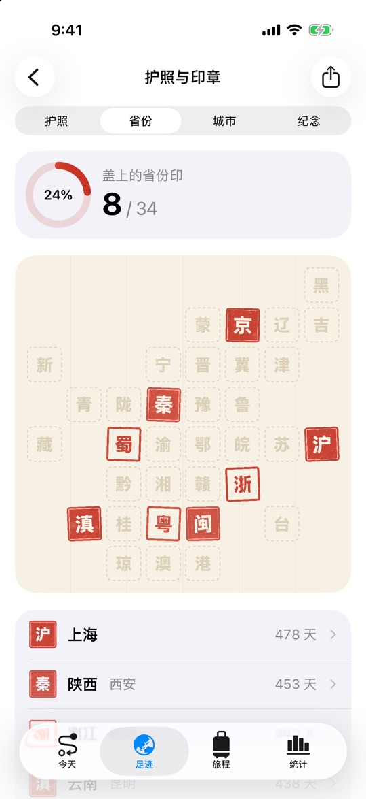
  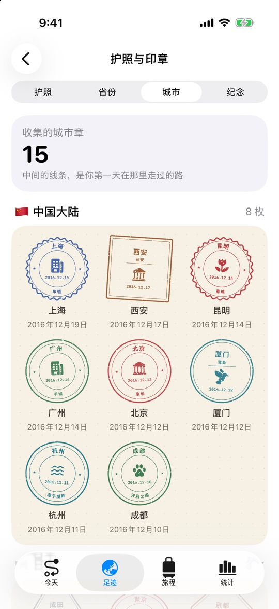
  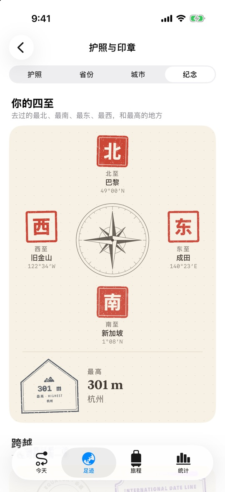
</p>

The places you've been aren't a number. They're stamps, pressed one by one into a passport you can leaf through.

- **Entry and exit stamps**: each country in its own script (日本国, 대한민국, SCHWEIZ · SUISSE), with the real date and the airport or border crossing; leaving adds an exit stamp, "stayed 9 days". Your home country doesn't stamp you: it issues the passport.
- **Province seals**: China's 34 provinces, each a cinnabar seal with its one-character name: 沪, 粤, 蜀, 黔, 滇, 秦, 陇… laid out roughly where they are.
- **City stamps**: one for every city, **with the path you walked on your first day there drawn in the middle**, so no two people's Shanghai stamp look alike. About 150 well-known cities have their own design: 北京 · 京华, 京都 · 古都, PARIS · LA VILLE LUMIÈRE.
- **Keepsakes**: crossing the equator or the date line, the Arctic Circle; where each New Year began; and **your four corners**, the farthest north, south, east and west you've been, written like an old deed, plus the highest point you've reached.
- **Sets**: visit every city in a group to earn its joint stamp: Jiangnan, the Six Ancient Capitals, the Silk Road, Yunnan, Kansai, the Swiss Alps, the American West and more, 14 in all, as carved seals, route maps or luggage labels.

**Stamping is the ceremony**, and each kind feels like the real thing:

| | Like | How it's pressed |
|---|---|---|
| Entry stamp | A customs rubber stamp | Hold, it comes down, a hard thump, the ink spreads |
| Province seal | A carved stone seal | Inked in a dish of paste, pressed, rocked side to side, lifted slowly |
| City stamp | A station date stamp | The date wheels roll to today, then a light tap |
| Keepsakes and sets | Gold foil | A line of light runs across it; a set's cities gather into its stamp |

Stamps not yet earned are **blind-embossed**: paper-coloured, in relief, every character readable but uninked.

**Four passports**: burgundy, navy, forest and midnight. Pick one the first time you open it: the cover's leather and gold or silver foil change together with the pages' paper and security print. Change it later in Settings; iCloud keeps every device the same.

---

## 🪪 Visa wallet

<p align="center">
  
  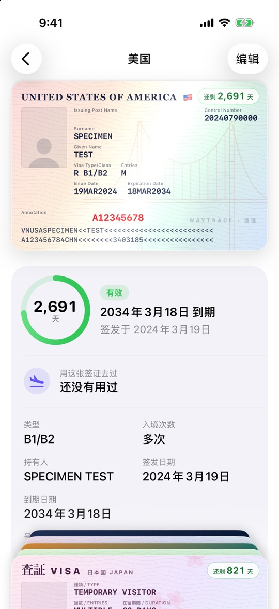
</p>

The visas in your passport, stacked like cards in Apple Wallet, each showing how many days it has left.

- **Laid out like the real ones**: the US foil with its Issuing Post Name, Control Number and red visa number over a bridge; the Schengen sticker's VALID FOR and DURATION OF STAY; Japan's bilingual 査証 VISA; and, for Australia and New Zealand, which put no label in the passport, a grant notice. No seals, emblems or security designs are copied, and every card carries a faint Waytrace mark.
- **Point and it's read**: aim the camera at a visa page and its country, type, entries, length of stay and dates are read live, with a torch if you need it. The two machine-readable lines are corrected field by field and checked against their check digits for the number, birth date and expiry; a few agreeing frames settle it, and the name is checked against the one printed above. Or read it from a photo, or type it in.
- **Leaf through it like Wallet**: tap a card and it rises to the top while the rest settle into a pile below; tilt the phone and it leans with a slow glint of light. Its back shows the days left as a ring and the details in a grid.
- **The sums done for you**: the Schengen 90/180 rule worked out from the days you've actually been there; how many times each visa has been used and for how long; a warning when your passport has under six months left. Reminders 90, 30 and 7 days before anything runs out.
- Visas live only in your own iCloud; reading happens on your iPhone, and nothing from the camera or your photos is saved or uploaded.

---

## 👥 Parallel footprints

See where your footprints and a friend's overlap: **passing within the same hour**, **in the same city on the same day**, or **at the same place at different times**.

- It appears only once you've invited each other and both agreed to share; no contacts, no groups, a friend is whoever accepted your invitation link.
- Only a summary is shared: the rough area you were in each day (about 20 km) and the square of about 1 km you were in each hour. Nothing within 2 km of home, work or school, no place names, exact coordinates, routes or photos.
- Shared through iCloud and compared on each phone; stop at any time and the summary is deleted from iCloud.

---

## 🌟 Places for a lifetime

<p align="center">
  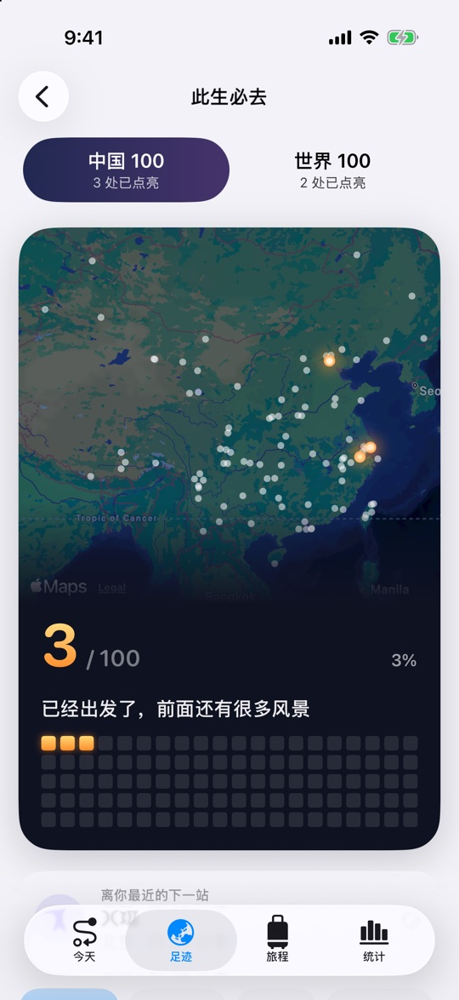
</p>

Two lists of Waytrace's own: **China 100** (Hong Kong, Macao and Taiwan included) and **World 100**, drawn from the World Heritage List, China's 5A scenic areas and the places travellers name most.

- **A night map**: places not yet reached are faint stars; places you've been glow warm gold.
- **A hundred small squares**: one fills for each place reached, so you can see how far you've come. The words change as you go, from "the first light is waiting for you" to "all one hundred".
- **No checking in**: stay nearby or take a photo there (imported photos count too) and it lights up on its own. A park is as big as the park.
- **A page for each place**: tap any of them to see it at its best: a real photograph, a few lines written for Waytrace, the best time to go and how far it is, plus a flight around it from the air and a walk through Look Around. Places you've been also show your own photos from there.
- **Back to that day**: from a place you've been, one tap opens the day you first got there, with that day's route and photos.
- **Want to go**: tap ♡ to keep a place for later, and see **your nearest next stop** and how far it is.
- **Newly lit**: places reached since you last looked get a moment of their own.
- **Recognised in Places**: wherever one of these places turns up among your footprints it carries a gold "Place for a lifetime" tag and a gold edge, with its real photograph as the cover if you have none of your own. Its page opens on that photograph and its story.

The photos are freely licensed works from Wikimedia Commons, shipped inside the app so they show everywhere, mainland China included. Each page credits the photographer and licence.

---

## 🎁 Travel blind box

<p align="center">
  
  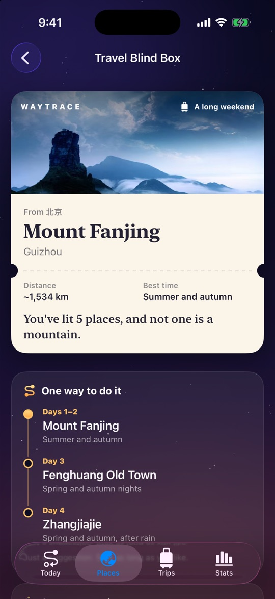
  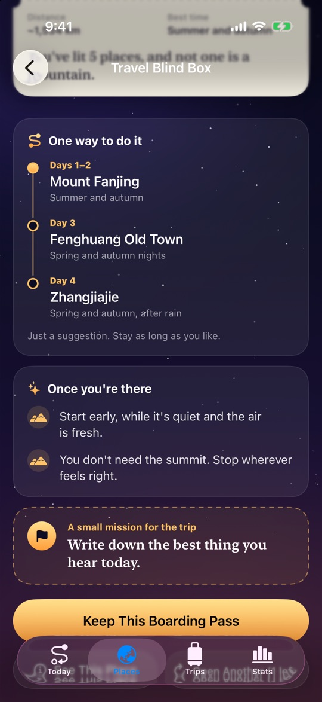
</p>

Don't know where to go? Open one. Waytrace knows where you've been, where you haven't and where you'd like to go, so the box only ever gives you somewhere **you haven't been yet**. It's on the Places tab, under Places for a Lifetime.

- **It knows what kind of day it is**: on a Saturday morning it's "You're free today. Why not go now?"; midweek it's "5 days to the weekend. Give yourself something to look forward to." When a Chinese public holiday is near (New Year, Spring Festival, Qingming, May Day, Dragon Boat, Mid-Autumn, National Day) it counts down to it and picks a fitting length for you.
- **How much time you have**: a day nearby, a weekend, a long weekend (three to five days) or a long break (about a week, further out).
- **How you want to feel**: anything, switch off, work up a sweat, old things, or city life.
- **Press and hold to open**: the box shakes harder and harder, the phone shakes with it, the lid flies off and a boarding pass flips over. Three a day.
- **A reason that's true**: it only says what your own footprints show, such as "You haven't lit a single must-see in Shanxi. Start here." or "You've lit 5 places, and not one is wild." Places on your wish list, and countries you hold a valid visa for, come up more often. Now and then it simply says: "No reason. That's what a blind box is."
- **A day nearby**: Apple Maps finds hills, water, old towns and streets near you that you haven't been to, with a time to set off (earlier if you're an early riser), the drive, and that day's weather, with a word if it'll rain.
- **Longer breaks**: a route that makes sense, such as "Days 1–2 Hukou Waterfall, Day 3 Mount Hua, Day 4 Terracotta Army", each stop with its best season. Just a suggestion; stay as long as you like.
- **Once you're there**: two ideas and **a small mission**, like "Arrive an hour before sunset, when the water looks its best" or "Bring home one small thing you can only get here."
- **Keep the boarding pass**: the place goes on your wish list. Passes never expire, and nothing nags you.
- **When you really get there**: Waytrace knows, and stamps an arrival postmark: "73 days ago, the box gave you this place. And you really came."

No payments, nothing social. Nearby places and weather are looked up with your rough location through Apple Maps and Apple Weather, and never leave Apple.

---

## ✨ Moments that make you pause

- **Back again**: return somewhere after more than a year and you're told gently, "you were last here on 12 April 2023", the days counting up, with your first visit, last visit and today in a line.
- **On this day**: on the Today page, where you were on this date in earlier years, the photo developing like a Polaroid.
- **Travel postcards**: every finished trip makes a postcard, a photo on the front, your words on the back, the city stamp as the postmark. Share it, or **send it to yourself a year from now**: when the day comes it drops onto the screen and turns over.
- **Milestone medals**: 23 illustrated medals in bronze, silver, gold and platinum. The newest leads the page; in each kind the one you're working towards is lit and says how far is left; open a medal to see which country or city earned it.
- **Seasonal echoes**: "three years in a row in Beijing around this time", or "five months since you last went to your usual café". At most once a week, each said only once.
- **That day's sky**: every place shows that day's sunrise and sunset and that night's moon; catch a sunset there and it says "you were here at sunset, 17:08". With the day's weather from Apple Weather.

### Your story

At the bottom of Stats, a set of cards about you:

- **Traveller portrait**: from the past year, are you a night walker, a city collector or a curious explorer? With your own numbers, ready to share.
- **How far you've come**: the distance you've travelled on the ground laid along the Grand Canal, China's Highway 318, the Silk Road or Route 66, lighting up each town you pass, each with a line about it.
- **Firsts**: first time abroad, first night away, first time out at 3 a.m., first time in each city and at each place for a lifetime, year by year; and the ends of your map: furthest north, south, east, west and from home.
- **Your year**: page by page like a story, with glowing city maps, a turning dotted globe, your longest day's route, a wall of photos and a page of **this year's passport**, ending in a poster to share.

<p align="center">
  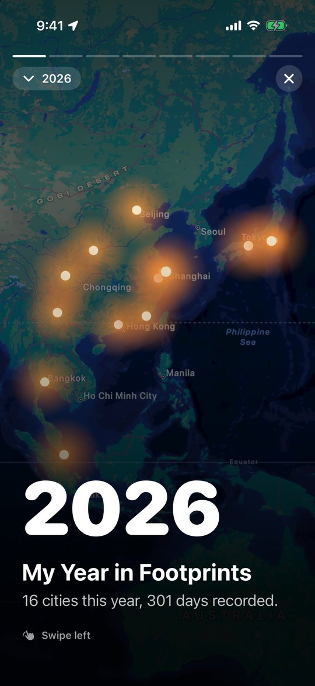
  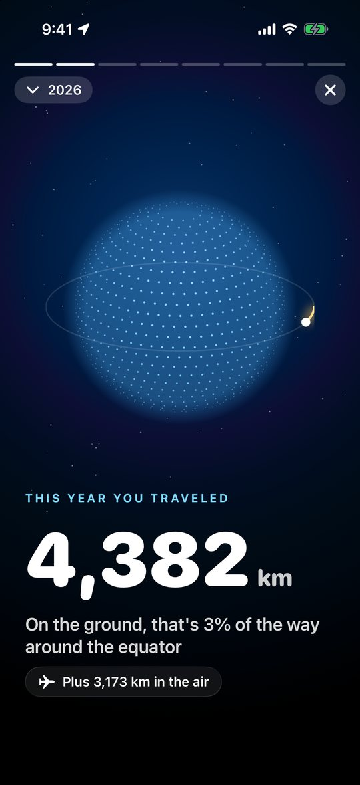
  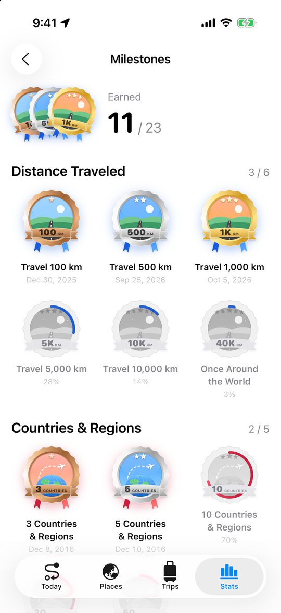
  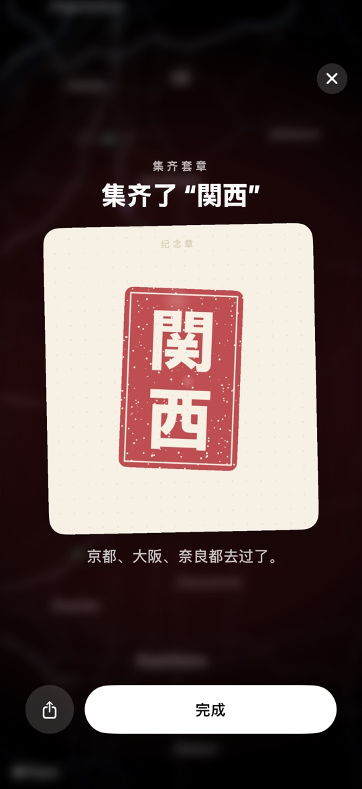
</p>

---

## ⌚ Apple Watch

- Opens to a map: where you are, today's route, the place you're at.
- Record hikes, runs and rides without your phone; start one on iPhone and the watch joins in.
- Complications: how far you've gone today and where you are.

---

## Privacy

Waytrace **has no server of its own**. Your routes, places, trips and photos live only on your devices and in your own iCloud; the developer can't see them. Place names come from Apple's map service, and photos are only read on the phone. See [PRIVACY.md](PRIVACY.md).

## Under the hood

| | |
|---|---|
| Interface | SwiftUI, MapKit, Swift Charts, iOS 26 Liquid Glass; every stamp is drawn live with `Canvas` and `Shape`, with no image assets |
| Storage and sync | SwiftData with a CloudKit private database; stamps are worked out from stays rather than stored; seen-stamp state and postcards sync through iCloud key-value storage |
| Background location | `CLLocationUpdate.liveUpdates` + `CLBackgroundActivitySession`; a `CLMonitor` geofence during long stays, with significant-change as a backstop |
| Places | `MKReverseGeocodingRequest`, `MKLocalPointsOfInterestRequest`; WGS-84 → GCJ-02 for maps in China |
| Every road | Each track simplified ahead of time at street, city and country detail, cached locally and read incrementally; drawn in layers of `MKMultiPolyline`, so overlaps brighten on their own |
| Visa reading | VisionKit `DataScannerViewController` live, Vision for photos; ICAO 9303 machine lines corrected per field and verified by check digit, with multi-frame voting; Core Motion drives the cards' sheen |
| Parallel footprints | CloudKit zone sharing (`CKShare`), summaries uploaded by day only when they change |
| Motion and health | CoreMotion for how you travel, HealthKit for steps |
| Apple Watch | watchOS SwiftUI app, WidgetKit complications, `HKWorkoutSession`, WatchConnectivity |
| Live Activities | ActivityKit: Lock Screen, Dynamic Island, watch Smart Stack |
| Languages | String Catalog, Simplified Chinese and English, switchable in the app; stamps print the place's own script, names around them follow the app's language |

Track points are compressed (LZFSE) into `TrackChunk`s, a few dozen CloudKit records a day. Countries, cities, stamps, milestones and trip finding are computed on a background thread; with 6,000 places and a passport of over a thousand pages, pages are still built only as they're turned. No third-party dependencies.

<details>
<summary>Project layout</summary>

```
RecordPath/
├── App/            Entry point, tabs
├── Persistence/    SwiftData models, track encoding, iCloud sync
├── Location/       Background location engine, travel mode
├── Places/         Place naming, frequent places
├── Health/         Steps
├── Account/        Sign in with Apple
├── Features/
│   ├── Today/          Today, timeline, on this day
│   ├── World/          Places, country pages, continent filter
│   ├── Stamps/         Passport, passport styles, stamp drawing, landing motion, keepsakes
│   ├── Visas/          Visa wallet, visa cards, live scanning
│   ├── Trips/          Trips, postcards
│   ├── Celebration/    Stamping ceremonies, back again, milestones
│   ├── Stats/          Stats, your year
│   ├── Onboarding/     Onboarding, places from Photos
│   └── Settings/
├── Watch/          Sync with the watch
└── Shared/         Stamp book and catalog, maps, photo import, trip finding, GPX
Common/             Code shared by iPhone, watch and complications
WaytraceWatch/      Apple Watch app
WaytraceWidgets/    Complications
WaytraceLiveActivity/  Live Activities
```
</details>

## Running it

- Xcode 26 or later; iOS 26+ (iPhone), watchOS 26+.
- Open `RecordPath.xcodeproj` and run the RecordPath scheme. There's nothing to install.
- To run on a device, change the Team under Signing to your own.
- Debug builds have Settings › Developer for demo data and ceremony previews, and launch arguments too:

```bash
# Unit tests
xcodebuild test -project RecordPath.xcodeproj -scheme RecordPath \
  -destination 'platform=iOS Simulator,name=iPhone 17' -only-testing:RecordPathTests

# Load demo data plus 6,000 photo places on launch (empty store only)
xcrun simctl launch booted com.honywen.waytrace -stressData

# Preview one kind of ceremony: province / city / country / special / set / reunion / postcard
xcrun simctl launch booted com.honywen.waytrace -ceremonySamples province

# Simulate a walk in the simulator
xcrun simctl location booted start --speed=12 31.2245,121.4466 31.2310,121.4650 31.2400,121.4900
```

Design decisions and field testing for each round are in [PRODUCT_REVIEW.md](PRODUCT_REVIEW.md); the pre-launch list is in [LAUNCH_CHECKLIST.md](LAUNCH_CHECKLIST.md).

## License

Licensed under **[PolyForm Noncommercial 1.0.0](LICENSE)**.

- ✅ Personal study, research, own use and modification, and use by nonprofits and educational institutions: yes.
- ❌ Any commercial use (including paid or ad-supported apps, or use in a company's products or services): no.
- For a commercial license, contact the author on GitHub.

Copyright © 2026 lxyeternal
